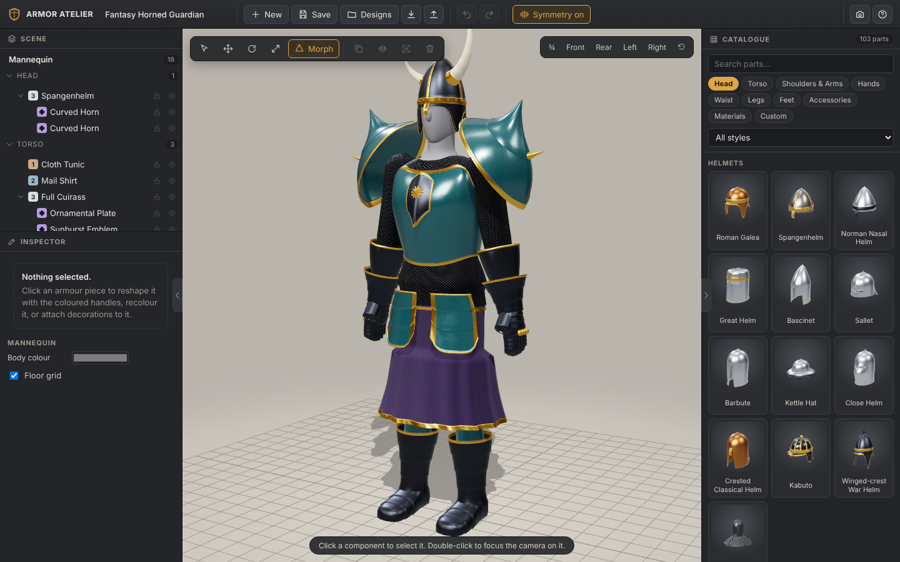

# Armor Atelier

A browser-based 3D armor design sandbox. Dress a neutral mannequin from a 103-part catalogue, reshape
every piece with viewport handles, layer cloth / mail / plate, attach horns, crests and faceplates to
any surface, recolour, and save reusable designs.



## Run it

```bash
npm install
npm run dev        # http://localhost:5173
npm run build      # type-check + production build in dist/
npm run preview    # serve the build on http://localhost:4173
```

Requires Node 20+ and a WebGL-capable browser. No external services or downloaded assets:
all geometry and textures are procedural.

## Test it

```bash
npm test                                   # 141 unit tests (vitest)
CHROME_PATH=/usr/bin/google-chrome npm run test:e2e   # 13 browser tests (Playwright)
```

See [docs/TESTING.md](docs/TESTING.md) for what is covered and the manual QA scripts.

## Controls

| Action | Input |
| --- | --- |
| Orbit / pan / zoom | drag / right-drag / scroll |
| Equip a part | click a catalogue card, or drag it onto the mannequin |
| Attach an accessory | click its card, then click an armor surface (green ghost = valid) |
| Reshape | select a piece, drag the coloured handles (amber trim, blue size, green profile) |
| Slide an accessory | drag the selected accessory across the surface |
| Tools | Q select, W move, E rotate, R scale, T morph |
| Undo / redo | Ctrl+Z / Ctrl+Shift+Z |
| Duplicate, mirror, focus, hide, delete | Ctrl+D, M, F, H, Del |
| Save | Ctrl+S |

Three finished example designs are under **Designs** in the top bar.

## Documentation

- [docs/ARCHITECTURE.md](docs/ARCHITECTURE.md) - systems, data model, how to add a component
- [docs/TESTING.md](docs/TESTING.md) - automated and manual tests
- [docs/PROGRESS.md](docs/PROGRESS.md) - what is done, known limitations, next steps
- [docs/DESIGN_NOTES.md](docs/DESIGN_NOTES.md) - design decisions and trade-offs
